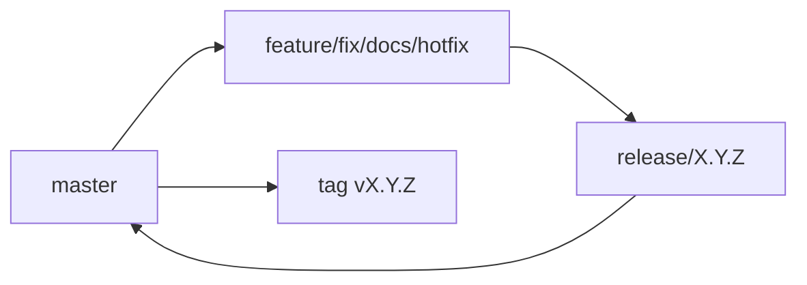

# Política GitFlow proposta

## Fluxo

- `master` é a linha de produção e deve receber somente PRs de `release/X.Y.Z`.
- Branches de trabalho são `feature/<descricao>`, `fix/<descricao>`, `docs/<descricao>` ou `hotfix/<descricao>`.
- Branches de release usam `release/X.Y.Z`, sem `v` no nome.
- Tags públicas usam `vX.Y.Z` e apontam para o commit pós-merge em `master`.
- Um hotfix não promove diretamente para `master`; ele entra numa release versionada para manter o mesmo caminho de validação.

## Versionamento

A estratégia atual é versionamento global do repositório, observado nas tags `v1.4.3` e `v1.5.0`. Não há evidência para migrar para versionamento independente por módulo. Qualquer mudança dessa estratégia deve ser aprovada separadamente, pois altera referências dos consumidores.
