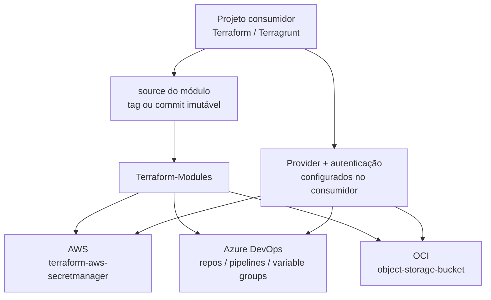

## Terraform Modules

Módulos Terraform reutilizáveis para AWS, Azure DevOps e OCI. Este repositório
mantém os módulos genéricos e deixa autenticação, ambientes e descoberta de
recursos existentes sob responsabilidade do consumidor.


## Arquitetura



O fluxo recomendado é escolher um módulo, fixar a referência em uma tag,
configurar o provider no projeto consumidor, revisar o `plan` e só então
executar o `apply`. Nenhum módulo configura credenciais ou backend por conta
própria.

## Módulos disponíveis

| Área | Módulo | Finalidade |
| --- | --- | --- |
| AWS | [`terraform-aws-secretmanager`](./aws/terraform-aws-secretmanager) | Cria vários secrets no AWS Secrets Manager. |
| Azure DevOps | [`repos`](./azure_devops/repos) | Cria, renomeia e padroniza repositórios e branches. |
| Azure DevOps | [`pipelines`](./azure_devops/pipelines) | Registra definições de pipelines YAML. |
| Azure DevOps | [`azuredevops_variablegroup`](./azure_devops/azuredevops_variablegroup) | Gerencia variáveis comuns e secretas. |
| OCI | [`object-storage-bucket`](./oci/object-storage-bucket) | Cria bucket privado, versionado e protegido. |

## Versão 1.4.2

Esta release consolida a documentação dos módulos, os diagramas renderizados
pelo GitHub e as orientações de consumo com referências imutáveis.

## Validação local

```bash
terraform fmt -check -recursive
terraform -chdir=oci/object-storage-bucket/example init -backend=false
terraform -chdir=oci/object-storage-bucket/example validate
terraform -chdir=azure_devops/pipelines/example init -backend=false
terraform -chdir=azure_devops/pipelines/example validate
```

Não execute `apply` ou `destroy` sem revisar e aprovar o plano.

---


Bem-vindo à documentação deste repositório de módulos Terraform. O objetivo deste projeto é criar módulos para uso pessoal, mas também torná-los disponíveis para que outros colaboradores da comunidade possam utilizá-los e contribuir para o seu aprimoramento.

<p>
  
</p>


### Objetivo

Este repositório tem como propósito centralizar módulos, documentações e exemplos práticos relacionados ao uso do Terraform. Aqui você encontrará:

- **Módulos reutilizáveis** para provisionamento de recursos.
- **Estruturas de implementação** aplicadas em plataformas como:
  - **Azure DevOps**
  - **AWS**

Explore, aprenda e contribua para expandir este repositório com ideias e melhorias!

---

### Azure DevOps

O **Azure DevOps** é um conjunto de ferramentas e serviços da Microsoft voltado para o gerenciamento completo do ciclo de vida do desenvolvimento de software, com foco em integração contínua (CI), entrega contínua (CD) e colaboração entre equipes de desenvolvimento. Ele oferece uma plataforma baseada em nuvem usada para planejar, construir, testar e implantar aplicações, automatizando e agilizando os fluxos de trabalho das equipes.

---

### Módulos Azure DevOps

Dentro da pasta **azure_devops**, você encontrará os módulos específicos para o Azure DevOps, com funcionalidades diversas. A seguir, destaco o módulo disponível:

#### 1. **terraform-azuredevops-repositorios**

Este módulo permite a criação de repositórios no Azure DevOps de maneira automatizada. Com ele, é possível realizar várias ações de uma única vez, como:

- Criar novos repositórios no Azure DevOps.
- Definir a branch **default** do repositório, ajustando conforme suas necessidades.

#### 2. **azure_devops/pipelines**

Registra uma definição de pipeline YAML em um projeto/repositório Azure DevOps
existente. A documentação de inputs, outputs, triggers e exemplo está em
[`azure_devops/pipelines`](./azure_devops/pipelines).

Este módulo facilita a configuração e o provisionamento de repositórios em sua organização, garantindo uma gestão eficiente e padronizada.

---

### Módulos OCI

O módulo [`oci/object-storage-bucket`](./oci/object-storage-bucket) cria um
bucket privado com versionamento e proteção contra destruição acidental. O
README inclui exemplos Terraform/Terragrunt e orientações específicas para o
state de bootstrap.

---

### Módulos AWS 

Dentro da pasta **aws**, você encontrará os módulos específicos para o Azure DevOps, com funcionalidades diversas. A seguir, destaco o módulo disponível:

#### 1. **terraform-aws-secretmanager**

Este módulo foi desenvolvido para simplificar a criação e o gerenciamento de secrets na AWS de forma automatizada e eficiente. Com ele, você pode realizar diversas ações simultaneamente, como:

- Criar múltiplos secrets na AWS em uma única execução.
- Definir o nome de cada secret de forma personalizada.
- Configurar o número de dias para o recovery window (janela de recuperação).
- Opcionalmente, atribuir um valor inicial ao secret (atenção: isso pode expor a senha no código; recomenda-se definir a senha posteriormente via console AWS para maior segurança).

Este módulo torna a configuração e o provisionamento de secrets mais rápidos e organizados, auxiliando no gerenciamento seguro de credenciais e informações sensíveis.

---

### Contribuição

Contribuições são muito bem-vindas! Se você deseja colaborar, siga as instruções abaixo:

1. Envie pull requests com suas alterações ou melhorias.
2. Caso encontre algum erro ou tenha sugestões, crie uma *issue* no repositório.

Agradecemos pela sua colaboração e interesse!

### Autores

- [@Edwanderson94](https://github.com/Edwanderson94)

---

### Considerações Finais

A maior motivação para a criação desses módulos foi a jornada de aprendizado e experiência que adquiri ao longo da minha trajetória profissional. Meu objetivo é compartilhar esse conhecimento, oferecendo módulos para Azure DevOps utilizando Terraform, com o intuito de proporcionar maior agilidade e eficiência aos projetos de outros profissionais.
