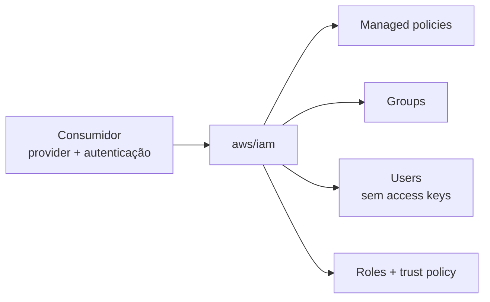

# AWS IAM

Módulo Terraform reutilizável para gerenciar identidades e permissões AWS sem
configurar provider, credenciais, account ou região. O consumidor fornece esses
valores e decide o escopo operacional.



## Escopo

- Cria managed policies com `aws_iam_policy`.
- Cria groups e associa managed/inline policies.
- Cria users, associa grupos e policies, sem criar access keys.
- Cria roles com trust policy, tags, permissions boundary e policies.
- Usa mapas indexados por chaves estáveis para reduzir diffs acidentais.

O módulo não cria access keys, login profiles, account aliases, roles de service
específicas, policies anexadas automaticamente por descoberta, nem configura
provider ou backend. Prefira roles e credenciais temporárias a usuários
programáticos permanentes.

## Uso

```hcl
module "iam" {
  source = "git::https://github.com/Edwanderson94/Terraform-Modules.git//aws/iam?ref=<tag-ou-commit-imutavel>"

  policies = {
    managed_policy_key = {
      name   = var.managed_policy_name
      policy = var.managed_policy_document
    }
  }

  roles = {
    role_key = {
      name               = var.role_name
      assume_role_policy = var.role_trust_policy
    }
  }
}
```

O exemplo em [`example`](./example) usa somente o nome solicitado `svc_codex` e
não contém credenciais. Para policies, groups e roles, o consumidor deve informar
os nomes reais e as policies de menor privilégio. Configure o provider AWS fora do
módulo usando a cadeia de credenciais adequada.

## Segurança e lifecycle

- Revise trust policies e permission policies com least privilege antes do apply.
- Não coloque secrets, access keys ou tokens em variáveis, exemplos ou state sem
  avaliar a proteção do backend.
- `force_destroy` de usuários permanece `false` por padrão.
- O módulo não usa `prevent_destroy` para identidades, pois a retenção e o ciclo de
  vida variam por ambiente; proteções adicionais devem ser definidas no consumidor.
- Renomear a chave de um mapa pode destruir e recriar o recurso correspondente;
  mantenha chaves estáveis e use `terraform state mv` somente em procedimento
  operacional aprovado.

## Inputs principais

| Nome | Tipo | Padrão | Descrição |
| --- | --- | --- | --- |
| `policies` | `map(object)` | `{}` | Managed policies criadas pelo módulo. |
| `groups` | `map(object)` | `{}` | Groups e policies associadas. |
| `users` | `map(object)` | `{}` | Users, grupos e policies; sem access keys. |
| `roles` | `map(object)` | `{}` | Roles, trust policies e permission policies. |

## Requisitos e validação

- Terraform `>= 1.0, < 2.0`.
- Provider `hashicorp/aws` `5.80.0`.
- A identidade do consumidor precisa de permissões para os recursos escolhidos.

Valide sem acessar ou alterar uma conta AWS:

```bash
terraform -chdir=example init -backend=false
terraform -chdir=example validate
```

Não execute `plan` contra uma conta ou `apply` sem confirmar account, região,
state, trust policy, permission policies e o plano revisado.
