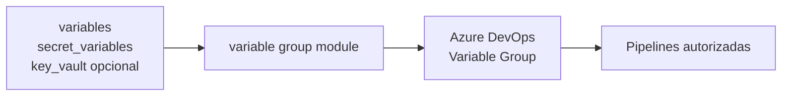

# Azure DevOps variable group



Módulo para criar e gerenciar um Variable Group em um projeto Azure DevOps
existente. O módulo pode administrar variáveis comuns, variáveis secretas e,
opcionalmente, vincular o grupo a um Azure Key Vault.

## Uso

```hcl
module "azuredevops_variablegroup" {
  source = "git::https://github.com/Edwanderson94/Terraform-Modules.git//azure_devops/azuredevops_variablegroup?ref=<tag-ou-commit-imutavel>"

  project_id   = data.azuredevops_project.infrastructure.id
  name         = "Terraform State"
  description  = "Variáveis usadas pelo bootstrap do estado Terraform"
  allow_access = true

  variables = {
    TF_LOG = "WARN"
  }

  secret_variables = {
    OCI_AUTH_TOKEN = var.oci_auth_token
  }
}
```

## Inputs

| Nome | Tipo | Obrigatório | Padrão |
| --- | --- | --- | --- |
| `project_id` | `string` | sim | — |
| `name` | `string` | sim | — |
| `description` | `string` | não | `null` |
| `allow_access` | `bool` | não | `false` |
| `variables` | `map(string)` | não | `{}` |
| `secret_variables` | `map(string)` | não | `{}` |
| `key_vault` | `object` | não | `null` |

`variables` e `secret_variables` não podem conter o mesmo nome. Os valores
secretos continuam sensíveis no Terraform, mas devem ser fornecidos por
variáveis protegidas ou secret stores; não os grave em código, logs ou arquivos
versionados.

Para `key_vault`, informe `name`, `service_endpoint_id` e `search_depth`.

## Importação

```bash
terraform import module.azuredevops_variablegroup.azuredevops_variable_group.this "<project-name>/<variable-group-id>"
```

Variable Groups com valores secretos não podem ser importados com seus valores
originais; o Azure DevOps retorna esses valores mascarados.

## Segurança e operações

- O consumidor configura o provider e a autenticação; o módulo não recebe PAT.
- `prevent_destroy` é ativado permanentemente no módulo. Para destruir o grupo,
  faça uma alteração deliberada no código do módulo após revisar o plano.
- O módulo não executa `apply`, não cria projetos, service connections,
  permissões ou pipelines.
- Revise o plano antes de aplicar, especialmente ao alterar ou remover variáveis
  secretas.

## Requisitos

- Terraform `>= 1.0, < 2.0`.
- Provider `microsoft/azuredevops >= 1.4.0, < 2.0.0`.
