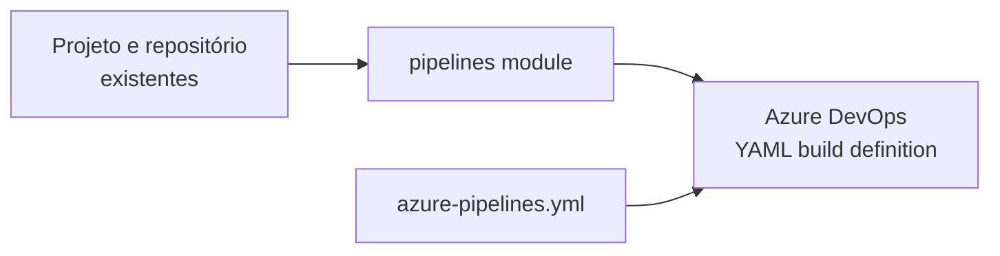

# Azure DevOps pipeline definition



Módulo para registrar uma definição de pipeline YAML em um projeto Azure DevOps
existente, apontando para um repositório Azure Repos (TfsGit). O módulo não cria
projeto, repositório, variable group, service connection, ambiente ou permissões.

## Uso

```hcl
module "terraform_state_pipeline" {
  source = "git::https://github.com/Edwanderson94/Terraform-Modules.git//azure_devops/pipelines?ref=<tag-ou-commit-imutavel>"

  project_id      = data.azuredevops_project.infrastructure.id
  name            = "Terraform State OCI Bootstrap"
  repository_id   = one(data.azuredevops_git_repositories.terraform_state.repositories[*].id)
  branch_name     = "refs/heads/feature/terraform-state-bootstrap"
  yml_path        = "/azure-pipelines.yml"
  path            = "\\"
  agent_pool_name = "Azure Pipelines"
  queue_status    = "enabled"
}
```

O projeto e o repositório devem ser resolvidos pelo consumidor. Isso mantém o
módulo genérico e explicita a dependência do pipeline em relação ao repositório.
O arquivo YAML controla CI/PR por meio de `ci_trigger.use_yaml = true`. A
primeira execução não é disparada na criação (`skip_first_run = true`).

## Inputs

| Nome | Tipo | Obrigatório | Padrão |
| --- | --- | --- | --- |
| `project_id` | `string` | sim | — |
| `name` | `string` | sim | — |
| `repository_id` | `string` | sim | — |
| `branch_name` | `string` | não | `refs/heads/master` |
| `yml_path` | `string` | não | `/azure-pipelines.yml` |
| `path` | `string` | não | `\\` |
| `agent_pool_name` | `string` | não | `Azure Pipelines` |
| `queue_status` | `string` | não | `enabled` |

## Outputs

| Nome | Descrição |
| --- | --- |
| `id` | ID da definição |
| `revision` | Revisão da definição |
| `name` | Nome configurado |

## Requisitos e segurança

- Terraform `>= 1.0, < 2.0`.
- Provider `microsoft/azuredevops >= 1.4.0, < 2.0.0`.
- O consumidor configura o provider e suas credenciais; não passe PAT como input
  do módulo.
- O provider 1.4.0 não aceita `job_authorization_scope` nesse recurso; não foi
  exposto para manter compatibilidade com a versão já fixada no stack consumidor.
- Para uso compartilhado, fixe `source` em tag ou commit imutável após publicar
  o módulo. Evite branches móveis em ambientes protegidos.
