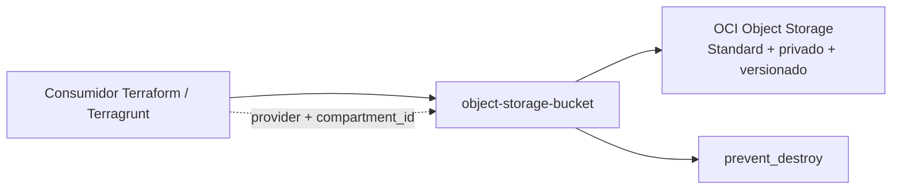

# Módulos OCI

| Módulo | Descrição |
| --- | --- |
| [`object-storage-bucket`](./object-storage-bucket) | Bucket privado Standard, versionado e protegido contra destruição acidental. |

Consulte o README de cada módulo para contrato, exemplo, requisitos e riscos.
